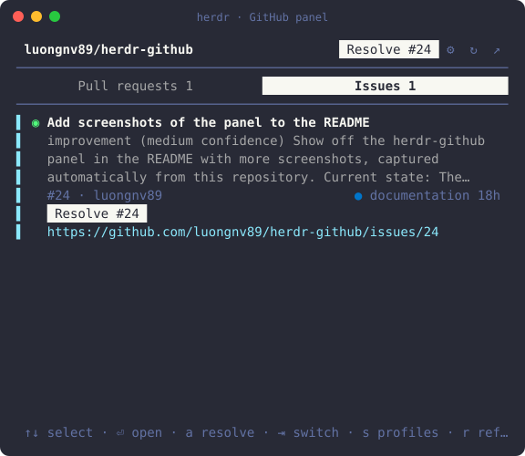

# herdr-github

The open pull requests and issues of the repo you're in, in a side pane of [herdr](https://herdr.dev). Works with GitHub and GitLab, including self-hosted GitLab and GitHub Enterprise.



Each row shows the title (up to 2 lines), the description (up to 3 lines) and a meta line:

- **Pull requests** (merge requests on GitLab): number, author and branch, a Draft chip, the review state (Approved, Changes requested, Review), the checks (✓ passed, ● pending, ✗ failed) and the age.
- **Issues:** number and author, up to 3 labels in their colors, and the age.

The selected row also shows its URL on one more line.

On GitLab, merge requests show as `!123` and have no checks mark: the list doesn't carry pipeline status. Their review state shows Changes requested and Review, but not Approved.

Click a pull request or issue, or select it and press enter, to open it in your browser. Clicking needs `ui.mouse_capture = true` in your herdr config. On a remote machine, see [Remote machines](#remote-machines).

On GitHub, each issue has a **Resolve** button and each pull request a **Review** button, which start an agent on it. Which agent, model and thinking level is up to you: see [Agent profiles](#agent-profiles). So is the prompt it gets: see [Custom prompts](#custom-prompts).

The repo also holds the same panel for the Herdr desktop app, in `mods/herdr-github` (see [Herdr app](#herdr-app)). The terminal panel is the twin of the GitHub panel in [Whole Herdr](https://github.com/luongnv89/whole-herdr), a layout for the Herdr desktop app.

## Install

```sh
herdr plugin install luongnv89/herdr-github
```

Then bind a key to it:

```sh
herdr plugin action invoke herdr-github.bind-key
```

This adds `prefix+i` to herdr's `config.toml` and reloads the config. The file is the one herdr reads: `HERDR_CONFIG_PATH` when that's set, else `$XDG_CONFIG_HOME/herdr/config.toml`, else `~/.config/herdr/config.toml`. If `prefix+i` is taken, it uses the first free `prefix+` letter instead, and it says which key it picked. If the panel already has a key, it changes nothing. If `herdr config check` already reports problems with the config, it changes nothing, exits 1 and quotes the first problem: fix the config, then run it again. If the check rejects the new binding, it leaves the config as it was and exits 1. It saves the old config next to it, as `config.toml.bak-herdr-github`. To choose the key yourself, run `node bind-key.js prefix+x` in the plugin folder (`herdr plugin list` shows where that is); it refuses a key that's already in use. Or add the binding by hand:

```toml
[[keys.command]]
key = "prefix+i"
type = "plugin_action"
command = "herdr-github.toggle"
description = "PR and issue panel"
```

Then run `herdr server reload-config`. Herdr plugins can't declare keys in their manifest, so installing the plugin doesn't bind one. Without a key, run `herdr plugin action invoke herdr-github.toggle`.

To update, run `herdr plugin update herdr-github`. To remove it, run `herdr plugin uninstall herdr-github`.

## Use

Press the key in any pane. The panel opens on the right, about a third of the tab wide. Press the key again in that tab to close it.

- **Which repo:** the folder of the last pane you focused in the panel's tab. It follows you when you `cd` or move to another pane.
- **Which site:** read from the repo's `origin` remote (or its first remote). A host name containing `github` uses `gh`, one containing `gitlab` uses `glab`, and any other host tries `gh`, then `glab`.
- **Keys:**
  - `↑`/`↓` or `j`/`k` select, page up/down jump, `g`/`G` go to the top or bottom;
  - enter opens the selected row in your browser;
  - tab or `←`/`→` switches between pull requests and issues, `1` and `2` choose one;
  - `r` refreshes, `o` opens the repo on GitHub or GitLab;
  - `a` resolves the selected issue, or reviews the selected pull request, with an agent (see [Resolve and review with an agent](#resolve-and-review-with-an-agent)). With more than one profile it opens a menu of them: `↑`/`↓` or `j`/`k` choose, enter starts the one chosen, and esc or `q` closes the menu without starting anything;
  - `s` opens the agent profiles (see [Agent profiles](#agent-profiles));
  - `q` or esc closes the panel.
- **Mouse:** click a row to open it, click the switch to change lists, click a row's `Resolve #N` or `Review #N` button, the same button in the header (for the selected row), `⚙`, `↻` or `↗` in the header, a profile in the menu those buttons open, and scroll with the wheel. This needs `ui.mouse_capture = true` in your herdr config. On a remote machine, Ctrl-click the selected row's URL instead (see [Remote machines](#remote-machines)).
- **When a row can't be opened:** the panel shows why in red, a hint to Ctrl- or Cmd-click the URL, and the whole URL above the key hints. The URL is a terminal hyperlink too. Any key, or the next open, clears it.
- **Fetching:** when the repo changes, every 2 minutes while the panel's tab is on screen, and on `r`. A panel in a tab you aren't looking at doesn't fetch.
- **Lists:** the 50 most recently opened of each on GitHub, and the 50 most recently updated on GitLab. The panel remembers which list you chose.

## Resolve and review with an agent

On GitHub, every issue row ends with a **Resolve #N** button and every pull request row with a **Review #N** button. The header shows the same button for the selected row, and `a` presses it. Resolve hands the issue to the `issue-resolver` skill, Review hands the pull request to `issue-pr-review`, unless you wrote your own prompt for the action (see [Custom prompts](#custom-prompts)). The agent that starts is the one in the profile you choose; with no profiles of your own, it's Claude Code started through `mcc run` (see [Agent profiles](#agent-profiles)).

### Choose the profile

With no profiles of your own, only the built-in one, a click or `a` starts it right away. With one or more of your own, a click or `a` first opens a menu that lists every profile, the built-in **Claude Code via mcc run** first, with the one assigned to the action highlighted (the built-in one when none is):

- **Terminal panel:** the menu opens under the button you clicked: under a row's **Resolve #N** or **Review #N** for that row (and for `a`, under the selected row's), or under the header for the header's button and for a row whose button is out of view. When there's no room under the button, it opens above it, and a menu longer than the room scrolls, with `↑` or `↓` on its border when there are more profiles that way. `↑`/`↓` or `j`/`k` move the highlight, enter starts the highlighted profile, and a click on a profile starts that one. Esc, `q`, the mouse wheel or a click anywhere else closes the menu and starts nothing: a click on a row then doesn't open it in your browser.
- **Herdr app:** the menu opens under a row's button for that row, and under the header for the header's button, `a` and the `resolve`, `review` and `act` commands. The same keys work, and a click on a profile starts it. Esc, `q`, or a click on a row, the switch or a header button closes it and starts nothing.

Whichever profile you choose, the action's custom prompt is sent, if it has one. The panel reads the profiles file again when you choose: if the profile was deleted meanwhile, or the row left the list in a refresh, nothing starts and the panel says why. Choosing doesn't change which profile is assigned to the action.

### What it runs

Once the profile is known, the panel:

1. takes the action's custom prompt from the profiles file, if it has one;
2. checks that the skill is installed for that agent: `issue-resolver` for an issue, `issue-pr-review` for a pull request (not with a custom prompt);
3. opens a new pane below your agent, in the repo's folder: below the agent in the pane the panel follows, else one in the panel's tab, else below the pane the panel follows (`herdr agent list`, then `herdr pane split`);
4. starts the profile's agent there, with its model and thinking level, and sends it the skill and the number: for Claude `/issue-resolver 12` or `/issue-pr-review 34`; other agents get "Use the issue-resolver skill on issue #12." With a custom prompt, it sends that prompt with the number filled in. Nothing from the title or description goes into the prompt.

Claude Code, Codex, Pi and OpenCode start with `herdr agent start`, with the profile's flags after `--`. Through mcc, the panel types `mcc run -- [flags] /issue-resolver 12` into the new pane's shell (with mcc's full path), every word quoted, and Claude Code takes the prompt as its first message.

Your own agent and its conversation are left alone. The panel shows what it is doing above the key hints, in yellow while it starts the agent, green once the agent is working on the prompt, and red with the reason when something fails. A pane whose agent failed to start is closed again.

If the new agent asks you something first, such as whether you trust the folder, the pane stays open and the panel waits up to 5 minutes for your answer, then sends the prompt. If the prompt is typed but the agent doesn't act on it, the panel presses Enter once more.

mcc can ask something before Claude Code starts, such as what to do about a usage limit. The panel waits up to a minute for herdr to see Claude Code in the new pane, then up to 30 seconds for it to settle. It says "Started" only when Claude Code is idle or working; otherwise it says **Answer mcc in the new pane: it is waiting there, maybe asking about a usage limit**. Answer mcc there, and Claude Code then works on the prompt.

If the skill isn't installed, nothing starts and the panel points you to [luongnv.com/idd](https://luongnv.com/idd) to install the skills. It looks for `<skill>/SKILL.md` in the `skills` folder of `~/.claude`, `~/.agents`, `~/.codex` and `~/.<agent>`, and of the same folders in the repo. For Claude it also looks in the plugins you have installed and not disabled (`~/.claude/plugins/installed_plugins.json`, `enabledPlugins` in `~/.claude/settings.json` and the repo's `.claude/settings*.json`), and in synced plugins, and sends a plugin's skill under the plugin's name, such as `/idd:issue-resolver 12`. For mcc, it runs `mcc env -q --shell bash` in the repo to find the Claude Code folder `mcc run` would use there, such as `~/.mcc/profiles/work`, and looks in that folder's `skills` too, and for plugins in that folder instead of `~/.claude`.

The buttons don't show on GitLab, because both skills work through `gh`.

## Custom prompts

Resolve and Review can each send a prompt you write instead of the IDD skill's. Write it with `{number}` where the issue's or pull request's number goes, such as:

```
Fix issue #{number} on a new branch, add a test, and open a pull request that closes it. Don't merge it.
```

`{number}` is required, can appear more than once, and is the only placeholder: the row's title and description never go into the prompt. The prompt is sent as written, as one argument, to every harness: through mcc it is the last word of the `mcc run` line (quoted, so `$`, quotes and backticks are just text), and other agents get it as their first message. A custom prompt is trimmed and has to:

- contain `{number}`;
- not start with `-`, `!` or `#`, which a harness would read as a flag, a shell command or a note;
- not hold a backslash, a line break, or a control, invisible (zero-width, bidi), private-use or unassigned character;
- be at most 500 characters with the longest number filled in.

A custom prompt needs no skill, so the panels don't look for one: the agent starts even when the IDD skills aren't installed. With mcc, `mcc` still has to be on your `PATH`. Since the prompt goes as written to every harness, `/issue-resolver {number}` runs the skill only on Claude Code (directly or through mcc); another agent reads it as plain text. A skill Claude Code has from a plugin needs the plugin's name, such as `/idd:issue-resolver {number}`.

Leave the prompt empty to send the default again: the skill and the number, as above.

- **Terminal panel:** in the profiles view (`s`), the **Resolve prompt** and **Review prompt** rows under the profiles show the prompt each action sends (dim: the default). `↓` past the last profile selects them, and so does the mouse wheel; `e` or enter (or the selected row's **Edit** button) edits one. Type the prompt, then enter (or **Save**) saves it and esc (or **Cancel**) goes back. A prompt that can't be saved shows why under it. Empty it, or click **Use default**, to send the default again. In a short pane, the wheel scrolls the prompt down to its buttons.
- **Herdr app:** in the profiles view (the gear, or `s`), the **Resolve prompt** and **Review prompt** boxes under the profiles hold each action's prompt, empty for the default. `↓` past the last profile goes into the Resolve prompt box, then the Review one, and `↑` goes back. Type into one, then enter or its **Save** saves it; a prompt that can't be saved shows why under the box. Keys typed into a box stay in it; esc leaves the box. The Resolve and Review buttons' tooltips say when they send your prompt.

The prompts are kept in the profiles file (see [Where they're kept](#where-theyre-kept)), so both panels send the same ones. A file with a custom prompt is version 2; without one, it stays version 1. A version of this panel from before custom prompts shows a version 2 file read only: it still starts the assigned profiles, but sends the default prompts, and never overwrites yours.

## Agent profiles

A profile says which agent Resolve or Review starts:

- **Name** and **id**: the id is 1 to 32 lowercase letters, digits or `-`. `default` is taken.
- **Harness**: Claude Code via `mcc run`, Claude Code, Codex, Pi or OpenCode.
- **Model** (optional): left empty, the harness uses its own default.
- **Thinking** (optional): only the levels the harness takes. Left empty, the harness uses its own default.

Resolve and Review each have their own profile: the one their menu highlights, ready for enter (see [Choose the profile](#choose-the-profile)). With none assigned, or when the assigned profile is deleted, that is the built-in **Claude Code via mcc run** profile, with no model or thinking flag. The built-in profile can be assigned but not changed or deleted.

How the fields become flags:

| Harness | Model | Thinking | Levels |
|---|---|---|---|
| Claude Code via `mcc run` | `--model M` | `--effort L` | low, medium, high, xhigh, max |
| Claude Code | `--model M` | `--effort L` | low, medium, high, xhigh, max |
| Codex | `-m M` | `-c model_reasoning_effort="L"` | low, medium, high, xhigh |
| Pi | `--model M` | `--thinking L` | off, minimal, low, medium, high, xhigh, max |
| OpenCode | none | none | none |

OpenCode has no model or thinking flag when it starts interactively, so a model set on an OpenCode profile is ignored. The profile form says so, and so does the notice when the agent starts.

A model is letters, digits and `. _ : / @ + -`, starting with a letter or digit. Spaces, quotes and other shell characters are refused, and so are aliases with brackets such as `opus[1m]`: use the full model name instead.

### Edit them

- **Terminal panel:** press `s`, or click `⚙` in the header. `↑`/`↓` select a profile, `n` adds one, `e` or enter edits it, `d` deletes it (`y` confirms), `R` assigns it to Resolve and `V` to Review. With the mouse, click a profile to select it; it then shows **Use for Resolve**, **Use for Review**, **Edit** and **Delete** buttons (the default profile only the first two), and **+ New** in the header adds one. In the form, `↑`/`↓` or tab move between fields, `←`/`→` or space step through the harness and thinking choices, typing edits a text field, enter (or the **Save** button) saves and esc (or **Cancel**, or `✕`) goes back. A field that can't be saved shows why under it. Keys typed into a field stay in the field: `q` doesn't close the panel. Esc in the list goes back to the rows. In a narrow pane the key hints wrap onto more lines.
- **Herdr app:** click the gear in the header, or press `s`. Each profile has **Use for Resolve**, **Use for Review**, **Edit** and **Delete** buttons; **New profile** adds one. The same keys as in the terminal panel work: `↑`/`↓` (or `j`/`k`) select a profile, `n`, `e` or enter, `d` (`y` confirms, any other key keeps it), `R` and `V`. The form has text fields for the name, id and model, and buttons for the harness and thinking level that offer only the allowed values. In the form, `↑`/`↓` move between fields, `←`/`→` or space step through the harness or thinking level the keys are on (it is framed), and enter saves. Keys typed into a text field stay in it. Esc goes from the form back to the list, and from the list back to the rows. The bar at the bottom shows the keys.

A profile that can't be saved shows why, in red, and nothing is written.

### Where they're kept

Both panels read and write the same file:

```
~/.config/herdr/plugins/config/herdr-github/profiles.json
```

The file is per machine: it lives on the machine where the panel runs. The terminal panel uses the file on the machine where its herdr server runs, so under `herdr --remote` or over ssh that's the remote machine's file. The app always uses the file on your own computer, even for a space on another machine. On one computer, a profile you make in one panel is there in the other.

The panels read the file when the profiles view opens and on every Resolve or Review click, and write it only while it still holds what they read. If the other panel changed it in the meantime, nothing is written, the view reads it again and asks you to make your change again. A file that isn't valid JSON, or is from a newer version of the panel, is shown read only and never overwritten; until you fix or delete it, the actions use the default. A file with a profile that can't be used (one edited by hand with a bad model, say) is read only too, so saving doesn't erase that profile or what it's assigned to: the view says which profile and why, the actions assigned to it use the default, and the other profiles still work. Fix or remove it in the file to save again. The same goes for a custom prompt that can't be used: the file is read only, and that action sends the default prompt until you fix it in the file.

## Herdr app

`mods/herdr-github` is the same panel as a Herdr app mod: the same rows, the same per-row Resolve and Review buttons, the same profiles and the same default. It reads the repo with `gh` or `glab` on the space's machine.

To install it, link the folder into the app's mods folder (`~/.config/herdr-app`, or `$HERDR_APP_HOME` when that's set):

```sh
git clone https://github.com/luongnv89/herdr-github
ln -s "$PWD/herdr-github/mods/herdr-github" "${HERDR_APP_HOME:-$HOME/.config/herdr-app}/mods/herdr-github"
```

Or copy the folder there instead of linking it. The first time the app sees the folder, it docks the panel on the right. In a copied folder, saving a file reloads the panel. The app doesn't see changes made through a link, so after editing a linked folder, or a `git pull` in the clone, make the link again (`ln -sfn` with the same two paths) or restart the app. To update, `git pull` in the clone and make the link again, or copy the folder again if you copied it.

If you use your own layout, the app may dock the panel as a column of its own, or not show it. Check `~/.config/herdr-app/layouts/<your layout>.json` for a block with `"mod": "herdr-github"`, and put it where you want it, for example in place of another panel in the side stack.

In the app, a Resolve or Review click (after you choose a profile, when there's more than one; see [Choose the profile](#choose-the-profile)) splits the tab you're in: the agent opens in a new pane to the right of the pane the panel follows (else to the right of the first terminal pane in that tab), as Cmd+D splits, in the repo's folder, and the other panes stay open. Start several one after another and their panes all go in that tab; you can start the next one as soon as the last one's pane is open. Claude Code, Codex, Pi and OpenCode start with the `run` the app's `programs.json` gives them, followed by the profile's flags. The app sends them the prompt as their first message (`hc send`) once the agent is idle, so a question it asks first, such as whether you trust the folder, never gets the prompt as its answer: answer it in the new pane, and the prompt follows. The app waits up to 5 minutes for that. A notice that a prompt wasn't sent stays up until you press a key or start another Resolve or Review, even when another agent gets its prompt meanwhile. mcc starts as `mcc run -- [flags] /issue-resolver 12`. With a custom prompt, that prompt takes the place of `/issue-resolver 12`, and `mcc env` runs only to check that mcc is there. For a space on another machine, the agent, `mcc env` and the skill lookup run on that machine, while the profiles and prompts come from your computer. The app doesn't say when mcc is ready, so for mcc the panel says it opened the pane, not that Claude Code started: if mcc asks something first, such as about a usage limit, answer it in the new pane.

Besides its own `localStorage` (which list you chose), the app mod writes only the profiles file, and runs `mkdir -p` for its folder the first time it saves one.

`keys.json` can send the panel `herdr-github:focus`, `herdr-github:refresh`, `herdr-github:resolve` (or `review`, `act`) and `herdr-github:settings`.

## Remote machines

A click or enter runs `open` (macOS) or `xdg-open` (Linux) on the computer where the panel runs, which is the computer where its herdr server runs. When that is a remote machine, it usually has no browser, so the panel shows the reason and the URL instead of opening it. To open a row on your own computer:

- **`herdr --remote`, or a pane on a saved SSH machine:** select the row, then Ctrl-click the URL shown under it. herdr opens a plain `https://` URL in the browser of the computer running the herdr client, which is yours. herdr 0.9.5 doesn't do this for terminal hyperlinks (OSC 8), so Ctrl-clicking the title does nothing. The URL has to fit on one line: in a panel too narrow for it, the panel breaks it after `https://` so it can't open a cut-off address, and you need to widen the panel to Ctrl-click it.
- **You `ssh` in, then run `herdr` there:** select and copy the URL the panel shows. Mouse capture sends your clicks to herdr, so hold your terminal's bypass modifier while you drag, for example Shift, or Option in some macOS terminals.
- **A remote Mac:** `open` works there, so the row opens in a browser on that Mac's own screen, not yours.

A plain click on a remote machine still can't open a browser on your computer.

## Needs

- herdr 0.9.5 or later, on macOS or Linux.
- Node 18 or later, as `node` on the `PATH` of the herdr server.
- For Resolve and Review with the default profile, `mcc` on that `PATH`, with the skills installed for the Claude Code profile it starts. Other profiles need their own agent installed instead.
- For GitHub repos, [`gh`](https://cli.github.com), logged in (`gh auth login`; add `--hostname` for GitHub Enterprise).
- For GitLab repos, [`glab`](https://gitlab.com/gitlab-org/cli), logged in (`glab auth login`; add `--hostname` for a self-hosted GitLab).

## What it runs

A herdr plugin runs as your user, with no sandbox. This one:

- runs `git` in the repo's folder to find its remote, then `gh` or `glab` there to read the repo and its open pull requests (or merge requests) and issues;
- runs `herdr` to find the focused pane, and to open, resize and close its own pane;
- when you click Resolve or Review, or press `a`: reads the profiles file, runs `herdr` to list the agents and split a new pane below your agent (or below the pane the panel follows), then either starts the profile's agent in it (`herdr agent start`) and sends it the skill and the number, or your custom prompt, or, for mcc, runs `mcc env` in the repo and types `mcc run -- … <prompt>` into the new pane (`herdr pane run`), and closes that pane again if `herdr agent start` or `herdr pane run` fails, except while the agent is asking you something; it reads the skill folders listed under [Resolve and review with an agent](#resolve-and-review-with-an-agent). With a custom prompt it doesn't run `mcc env` or read the skill folders;
- runs `open` (macOS) or `xdg-open` (Linux) when you open a row or the repo, on the computer where its herdr server runs (see [Remote machines](#remote-machines));
- when you run `bind-key`: runs `herdr --default-config` and `herdr config check` to find a free key and check the config, adds one `[[keys.command]]` binding to herdr's `config.toml` (see [Install](#install)), saves the old config next to it as `config.toml.bak-herdr-github`, runs `herdr server reload-config`, and shows the result as a herdr notification;
- when you save in the profiles view: writes `~/.config/herdr/plugins/config/herdr-github/profiles.json`, creating its folder if needed, through a temporary file next to it (see [Where they're kept](#where-theyre-kept));
- otherwise writes only under its herdr state folder (`~/.local/state/herdr/plugins/herdr-github/` on macOS): which list you chose, and the ids of its open panes.

It sends nothing anywhere except through `gh` to GitHub, or `glab` to GitLab.

## Troubleshooting

- **"Not a git repository":** the focused pane's folder isn't inside a git repo. `cd` into one, or focus a pane that is.
- **A `gh` or `glab` error in red:** run the same command in that folder, for example `gh pr list` or `glab mr list`, to see the full message. Most often the CLI isn't logged in.
- **"gh isn't installed" or "glab isn't installed":** the repo's site needs that CLI on the `PATH` of the herdr server. Install it (see [Needs](#needs)) and log in.
- **"No GitHub or GitLab remote":** the repo has no remote, or only a local-path one. Pull requests and issues live on a hosting site, so there is nothing to list.
- **Grey label dots on GitLab:** the label colors come from `glab label list`, which failed. Check `glab auth status`.
- **A row doesn't open, and the panel shows its URL with a red reason:** `open` or `xdg-open` is missing or failed, most often because the panel runs on a remote machine. See [Remote machines](#remote-machines).
- **"The issue-resolver skill isn't installed" or "The issue-pr-review skill isn't installed":** install the skills from [luongnv.com/idd](https://luongnv.com/idd) for the agent named in the message, then try again.
- **"Claude Code isn't ready in the new pane" (or Codex, Pi, OpenCode) or "Send it yourself in the new pane":** the agent didn't take the prompt, for example because its startup question went unanswered for 5 minutes. Answer it, then type the command the notice shows, such as `/issue-resolver 12`.
- **"No agent in this tab and no pane to start one next to":** the panel opens the new pane below your agent, or below the pane it follows. Click a pane in the panel's tab, then try again.
- **"No pane to split" (in the app):** the app opens the new pane to the right of the pane the panel follows, or of the first terminal pane in its tab. Click a terminal pane, then try again.
- **"can't tell which terminal it is" (in the app):** the agent's pane opened, but the app didn't find exactly one new terminal in the tab, so it sent nothing. Type the prompt the notice shows into the new pane.
- **"didn't start in a new pane" (in the app):** no new pane opened, most often because Herdr can't find the agent's program, and Herdr shows its own message (`terminal.open failed`). Herdr checks the agent is installed in a login shell, which reads `~/.zshrc`, but starts it with herdr-core's own `PATH`, which doesn't. Link the program into a folder on that `PATH`, such as `~/.local/bin` (`ln -s ~/.opencode/bin/opencode ~/.local/bin/`), or pick another profile. Once the agent runs, type the prompt the notice shows.
- **"mcc isn't on your PATH":** the default profile starts Claude Code through `mcc run`. Install mcc on the machine where the panel runs, or assign another profile to Resolve or Review (`s`, or the gear in the app).
- **"The issue-resolver skill isn't found for mcc":** `mcc env -q --shell bash`, run in the repo, didn't name a Claude Code folder. Run it there yourself to see why.
- **"Answer mcc in the new pane":** mcc asked something before starting Claude Code, most often about a usage limit. Answer it in the new pane; Claude Code then works on the prompt.
- **"The profiles changed elsewhere and were read again":** the other panel saved the profiles file after this one read it. Make your change again.
- **"The profiles file isn't valid JSON" or "is version N":** the file is read only until you fix or delete it, and the actions use the default meanwhile. An older version of the panel says "is version 2" once a custom prompt is saved: update it, or clear both prompts in an up-to-date panel.
- **"Resolve prompt: must contain {number}" (or another reason under a prompt):** a custom prompt needs `{number}` where the number goes, and has to fit the rules under [Custom prompts](#custom-prompts). Nothing is saved until it does.
- **"A prompt in the file can't be used":** a prompt edited by hand in the profiles file breaks those rules. Its action sends the default meanwhile, and the file is read only: fix or remove the prompt in the file.
- **A custom prompt like `/issue-resolver {number}` does nothing on Codex, Pi or OpenCode:** a custom prompt is sent as written, and only Claude Code runs a `/skill` as a command. Write it as prose for other agents, such as `Use the issue-resolver skill on issue #{number}.`, or leave it empty for the default.
- **Saved SSH machines and `herdr --remote`:** the panel runs `git`, `gh` and `glab` on the computer where its herdr server runs. Ctrl-clicking the selected row's URL there to open it on your own computer hasn't been tested live yet.

## Develop

```sh
git clone https://github.com/luongnv89/herdr-github
cd herdr-github
herdr plugin link "$PWD"
node --test
```

A linked plugin runs straight from your folder, so a change shows the next time the panel opens. `node panel.js` also runs the panel in any terminal, for the current folder.

- `herdr-plugin.toml`: the manifest, with two actions (`toggle`, `bind-key`) and one pane (`panel`).
- `toggle.js`: opens the panel beside the focused pane, or closes it.
- `bind-key.js`: binds a key to `toggle` in herdr's config.
- `panel.js`: the panel itself. Plain Node, no npm packages.
- `mods/herdr-github/`: the Herdr app mod. `main.js` is the panel, `forge.js` its rules for rows, forges and agent actions, and `profiles.js` the agent profiles, shared with `panel.js`.
- `profiles.cjs`: the terminal panel's copy of `mods/herdr-github/profiles.js`, generated. Edit `profiles.js`, then run `node scripts/sync-profiles.mjs`. CI fails when the two differ (`node scripts/sync-profiles.mjs --check`).
- `test/`: unit tests for the text and row rendering, for reading GitHub and GitLab JSON, for which row a click opens, for what a failed open shows and how URLs and links are drawn, for what Resolve and Review run for each harness, with stand-ins for `herdr` and `mcc`, for the profiles and their file, for the app mod's rules, and for which key `bind-key` picks and how it edits the config.

`mods/herdr-github/gpui-kit.d.ts` is written by the app's runtime each time the mod runs, and is not in git.

## License

[MIT](LICENSE)
